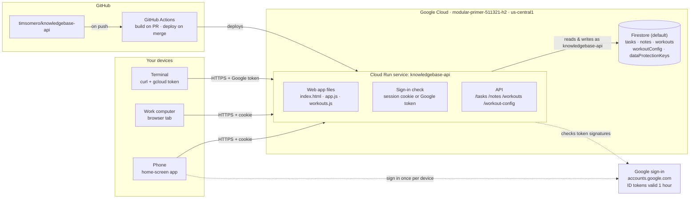
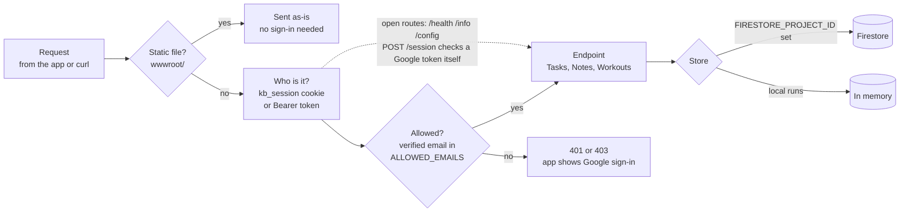
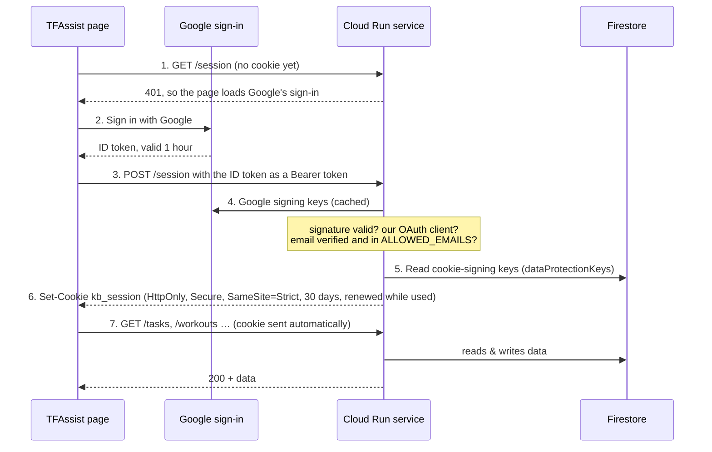
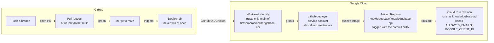

# TFAssist architecture

One ASP.NET Core service on Cloud Run serves both the web app and its API, keeps everything in
Firestore, signs you in with Google, and redeploys itself from GitHub whenever `main` changes.

> Drawn from the code on `main` at commit `a78efcb` (PR #6), Oct 18, 2026. This page is updated
> after major features or architectural changes, not every small tweak, so check the code when in doubt.
> [`architecture.html`](architecture.html) has the same content as a styled page (open it in a browser).

| | |
|---|---|
| Live URL | https://knowledgebase-api-831913024648.us-central1.run.app |
| Google Cloud project | `modular-primer-511321-h2` (number `831913024648`) |
| Runtime | .NET 10 container on Cloud Run, `us-central1`, up to 2 instances, 512 MiB |
| Data | Firestore `(default)` database, `us-central1` |
| Sign-in | Google account on an allowlist, then a 30-day session cookie |
| Deploys | GitHub Actions on every merge to `main`, no stored keys |

## The whole system



Your phone and work browser send the session cookie with each request; the terminal sends a fresh
Google token instead, so curl keeps working. Only the Cloud Run service touches Firestore.

## What happens to a request



The allowlist check runs on every API call, including ones carrying a valid cookie, so removing an
email from `ALLOWED_EMAILS` locks that account out right away. Without `FIRESTORE_PROJECT_ID`, data
lives in memory and is lost on restart.

| Route | Methods | Access | What it does |
|---|---|---|---|
| `/` and files | GET | open | The TFAssist web app |
| `/health`, `/info` | GET | open | Liveness, and which storage and sign-in mode is active |
| `/config` | GET | open | Tells the app which Google OAuth client to sign in with |
| `/session` | POST · GET · DELETE | Google token | Trade a Google ID token for the 30-day cookie; check it; sign out |
| `/tasks`, `/tasks/{id}` | GET · POST · PATCH · DELETE | signed in | Tasks: status, priority, due date, tags |
| `/workouts`, `/workouts/{id}` | GET · POST · PUT · DELETE | signed in | Logged workouts, newest first; `?from`, `?to`, `?limit` |
| `/workout-config` | GET · PUT | signed in | Workout categories and their activity or muscle-group lists |
| `/notes`, `/notes/{id}` | GET · POST · DELETE | signed in | The original notes API (no screen in the app) |

## How sign-in works



Steps 1–6 happen once per device, or after 30 days without opening the app.

- **From a terminal:** `gcloud auth print-identity-token` gives a Google token for your account; send it
  as `Authorization: Bearer …` on every request. The service accepts tokens from both the web app's
  OAuth client and gcloud's.
- **Sign out everywhere:** delete the `dataProtectionKeys` collection in the Firestore console. Every
  session cookie stops working, and each device asks for Google sign-in again.

## What's stored in Firestore

The service reads whole collections and sorts in memory, which is fine at personal scale and needs no indexes.

| Collection | One document per | Fields |
|---|---|---|
| `tasks` | task (id = GUID) | `title`, `notes`, `status`, `priority`, `dueDate`, `tags`, `createdAt`, `updatedAt`, `completedAt` |
| `workouts` | workout (id = GUID) | `date`, `categoryId`, `categoryName`, `kind`, `activity`, `items`, `durationMinutes`, `distanceMiles`, `notes`, timestamps. The category's name and kind are copied in, so Config changes never rewrite history. |
| `workoutConfig` | one document, `default` | `categories`: a list of `{id, name, kind, items}`. `kind` is `activity` (pick one + duration) or `checklist` (tick any). Until it's first saved, built-in defaults are used. |
| `notes` | note (id = GUID) | `text`, `createdAt` |
| `dataProtectionKeys` | signing key | `xml`: the keys that sign session cookies, managed and rotated by ASP.NET Core |

## The web app

The web app is one HTML page with plain JavaScript and no framework or build step. The part of the URL
after `#` picks the screen, so the phone's back button moves between screens.

| Address | Screen | Code |
|---|---|---|
| `/` | Tasks, with the Log Workout button | `app.js`: sign-in, routing, tasks |
| `/#workout` | Log Workout and Recent workouts | `workouts.js` |
| `/#workout/<id>` | Edit workout | `workouts.js` |
| `/#workout/config` | Config: categories and their lists | `workouts.js` |

Styles are in `app.css` (light and dark). `manifest.webmanifest` and `icon.svg` make it installable as
"TFAssist" on a home screen.

## How a change reaches the live app



A merge to `main` is live in about two minutes. After the rollout the job lets `allUsers` reach the URL;
the app's own sign-in decides who gets data. The app refuses to start without `ALLOWED_EMAILS`, so a bad
config fails the deploy before the service is opened to the internet. `deploy.ps1` still works for
deploying by hand from Windows.

## Who can do what

| Identity | Used by | Allowed to |
|---|---|---|
| Your Google account | You, on any device | Use the app and API (it's in `ALLOWED_EMAILS`); owns the GCP project |
| `knowledgebase-api@…` | The running Cloud Run service | `roles/datastore.user`: read and write Firestore, nothing else |
| `github-deployer@…` | GitHub Actions deploy job | `run.admin` on the project, `artifactregistry.writer` on the `knowledgebase` repo, act as `knowledgebase-api` |
| Workload Identity pool `github` | GitHub's OIDC tokens | Become `github-deployer`, only for pushes to `main` of `timsomero/knowledgebase-api` |
| `allUsers` | Anyone on the internet | `run.invoker`: reach the URL. Without your sign-in they get the page and 401s, never data. |

## Settings on the Cloud Run service

| Variable | Set by | Effect |
|---|---|---|
| `FIRESTORE_PROJECT_ID` | every deploy | Turns on Firestore storage; without it data lives in memory |
| `ALLOWED_EMAILS` | setup script, once | Google accounts allowed in; required with Firestore, or the app won't start |
| `GOOGLE_CLIENT_ID` | setup script, once | The OAuth web client the sign-in button uses; its authorized origin is the run.app URL |
| `PORT` | Cloud Run | 8080; the container listens there |

## Where things live in the repo

```text
.github/workflows/deploy.yml      # build on PR, deploy on merge to main
Dockerfile                        # .NET 10 SDK build → small ASP.NET runtime image, non-root
setup-github-deploy.sh            # one-time GCP setup for GitHub deploys
deploy.ps1                        # deploy by hand from Windows
docs/                             # this page and architecture.html
src/KnowledgeBase.Api/
  Program.cs                      # storage choice, sign-in, route wiring
  Auth/FirestoreXmlRepository.cs  # cookie-signing keys in Firestore
  Tasks/  Workouts/  Notes/       # endpoints + Firestore and in-memory stores
  wwwroot/                        # index.html, app.js, workouts.js, app.css, manifest
```

## Worth knowing

- **No backups yet.** Firestore point-in-time recovery or scheduled backups aren't turned on, so a deleted
  task or workout can't be recovered.
- **No automated tests in the repo.** Changes have been tested by hand and with throwaway browser scripts;
  the only CI check is that the code builds.
- **Single region.** Cloud Run and Firestore both run in `us-central1`.
- **Whole-collection reads.** Lists load every document and sort in memory: fine for one person, but years
  of heavy logging would eventually want Firestore queries and indexes.
- **GitHub Actions warning.** The workflow's actions run on an older Node.js version GitHub is phasing out;
  bumping their versions is a small follow-up.
