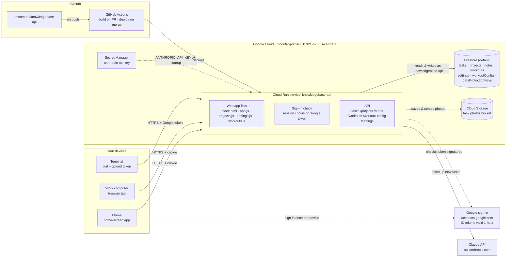
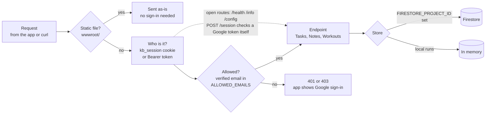
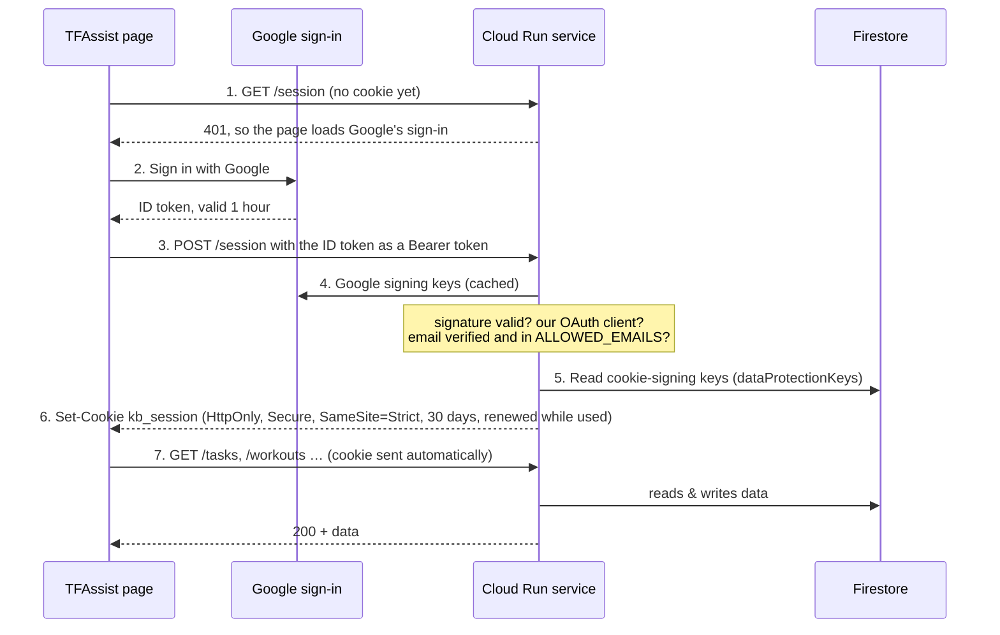
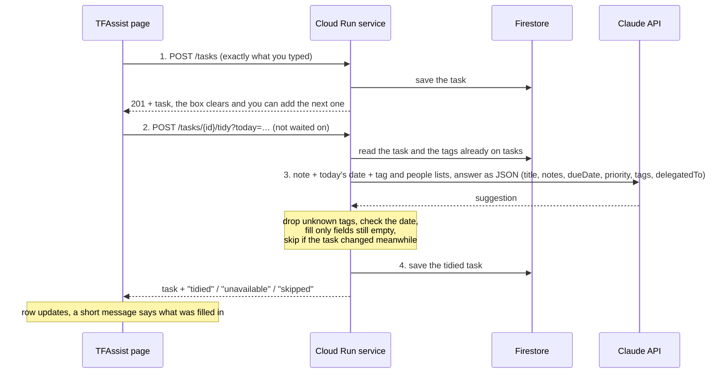
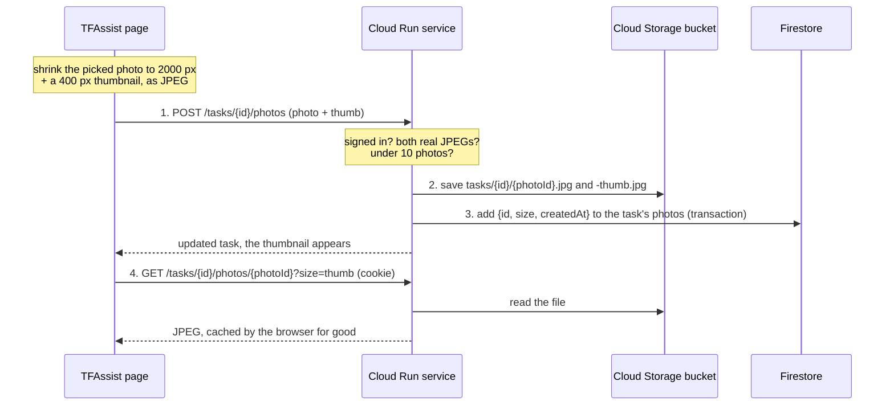
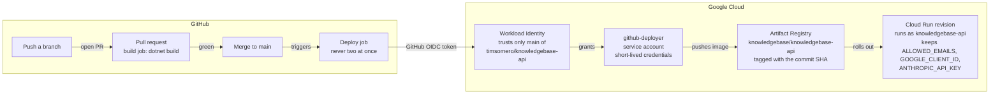

# TFAssist architecture

One ASP.NET Core service on Cloud Run serves both the web app and its API, keeps its data in
Firestore and task photos in Cloud Storage, signs you in with Google, tidies up new tasks with Claude,
and redeploys itself from GitHub whenever `main` changes.

> Drawn from the code on `main` at commit `e5f3166` (PR #29), Oct 29, 2026. This page is updated
> after major features or architectural changes, not every small tweak, so check the code when in doubt.
> [`architecture.html`](architecture.html) has the same content as a styled page (open it in a browser).

| | |
|---|---|
| Live URL | https://knowledgebase-api-831913024648.us-central1.run.app |
| Google Cloud project | `modular-primer-511321-h2` (number `831913024648`) |
| Runtime | .NET 10 container on Cloud Run, `us-central1`, up to 2 instances, 512 MiB |
| Data | Firestore `(default)` database, `us-central1`; task photos in a private Cloud Storage bucket |
| Sign-in | Google account on an allowlist, then a 30-day session cookie |
| Deploys | GitHub Actions on every merge to `main`, no stored keys |
| AI | Claude (`claude-haiku-5-5`) tidies up new tasks; API key in Secret Manager |

## The whole system



Your phone and work browser send the session cookie with each request; the terminal sends a fresh
Google token instead, so curl keeps working. Only the Cloud Run service touches Firestore and the photo
bucket, and only it talks to Claude: the text of a new task is sent to Anthropic's API to be tidied up,
nothing else (never photos).

## What happens to a request



The allowlist check runs on every API call, including ones carrying a valid cookie, so removing an
email from `ALLOWED_EMAILS` locks that account out right away. Without `FIRESTORE_PROJECT_ID`, data
lives in memory and is lost on restart.

| Route | Methods | Access | What it does |
|---|---|---|---|
| `/` and files | GET | open | The TFAssist web app |
| `/health`, `/info` | GET | open | Liveness; which storage, sign-in mode and build are running, and whether the assistant is on |
| `/config` | GET | open | Tells the app which Google OAuth client to sign in with, the build, and whether the assistant is on |
| `/session` | POST · GET · DELETE | Google token | Trade a Google ID token for the 30-day cookie; check it; sign out |
| `/tasks`, `/tasks/{id}` | GET · POST · PATCH · DELETE | signed in | Tasks: status, priority, due date, tags, who it's delegated to, and Personal or Work (with a work category) |
| `/tasks/{id}/tidy` | POST | signed in | Has Claude tidy up a task saved as typed; `?today` is your local date |
| `/tasks/{id}/photos`, `/tasks/{id}/photos/{photoId}` | POST · GET · DELETE | signed in | Attach a photo (JPEG + thumbnail), get one (`?size=thumb`), remove one |
| `/workouts`, `/workouts/{id}` | GET · POST · PUT · DELETE | signed in | Logged workouts, newest first; `?from`, `?to`, `?limit` |
| `/workouts/streak` | GET | signed in | Days in a row with a workout, for the streak badge; `?today` is your local date |
| `/workout-config` | GET · PUT | signed in | Workout categories and their activity or muscle-group lists |
| `/settings` | GET · PUT | signed in | The Settings screen: the work categories offered in Work mode |
| `/projects`, `/projects/{id}` | GET · POST · PATCH · DELETE | signed in | Work projects on the Projects board: category, size, health, target date, notes |
| `/projects/{id}/checkin`, `/projects/{id}/log`, `/projects/{id}/log/{entryId}` | POST · DELETE | signed in | Check a project in; add or remove a line in its activity log |
| `/notes`, `/notes/{id}` | GET · POST · DELETE | signed in | The original notes API (no screen in the app) |

## How sign-in works



Steps 1–6 happen once per device, or after 30 days without opening the app.

- **From a terminal:** `gcloud auth print-identity-token` gives a Google token for your account; send it
  as `Authorization: Bearer …` on every request. The service accepts tokens from both the web app's
  OAuth client and gcloud's.
- **Sign out everywhere:** delete the `dataProtectionKeys` collection in the Firestore console. Every
  session cookie stops working, and each device asks for Google sign-in again.

## How a new task gets tidied up



- **Saved first, tidied second.** The task is stored before Claude is involved, so a slow or failed tidy-up
  never loses it: no key, an outage, a timeout (30 seconds) or an odd answer all mean "leave it as typed".
- **Your choices win.** Notes, due date and tags are filled only while empty, priority only while it is
  normal, and a task you edit or complete before the answer arrives is left alone.
- **Tags and people never get invented.** Claude chooses from the tags and the delegated-to names already on
  your tasks; adding one to any task by hand makes it available to the next one. It never sets or changes a
  task's Personal/Work list or work category.
- **Model and cost.** `claude-haiku-5-5` at low effort, with the answer constrained to a JSON schema,
  in `Tasks/ClaudeTaskAssistant.cs`; well under a tenth of a cent per task. Local in-memory runs use a simple stand-in
  (`LocalTaskAssistant`), and without `ANTHROPIC_API_KEY` the app skips the tidy-up.

## How photos on tasks work



- **Small uploads.** The phone shrinks each photo before sending it, so uploads are a few hundred KB, and
  iPhone HEIC photos arrive as JPEG.
- **Private.** The bucket blocks public access; only the service's account can use it, and the app serves
  each image after the same sign-in check as everything else, only if it belongs to that task.
- **Never lost to an edit.** A task's photo list changes only in a Firestore transaction, and task edits
  merge without it, so an edit and an upload at the same moment both survive.
- **Cleanup.** Deleting a photo or a task deletes the files; Cloud Storage keeps deleted files recoverable
  for 7 days. Up to 10 photos per task. Without `PHOTO_BUCKET`, photos are off and the app hides them.

## What's stored in Firestore

The service reads whole collections and sorts in memory, which is fine at personal scale and needs no indexes.

| Collection | One document per | Fields |
|---|---|---|
| `tasks` | task (id = GUID) | `title`, `notes`, `status`, `priority`, `dueDate`, `tags`, `delegatedTo`, `area` (`Personal` or `Work`), `category` (work tasks only), `createdAt`, `updatedAt`, `completedAt`, `photos` (a list of `{id, size, createdAt}`; the images are in Cloud Storage). A task saved before Work mode has no `area`; it counts as Work when tagged `#work`. |
| `workouts` | workout (id = GUID) | `date`, `categoryId`, `categoryName`, `kind`, `activity`, `items`, `durationMinutes`, `distanceMiles`, `notes`, timestamps. The category's name and kind are copied in, so Config changes never rewrite history. |
| `workoutConfig` | one document, `default` | `categories`: a list of `{id, name, kind, items}`. `kind` is `activity` (pick one + duration) or `checklist` (tick any). Until it's first saved, built-in defaults are used. |
| `projects` | project (id = GUID) | `name`, `category`, `size` (`Small`/`Medium`/`Large`, only sets the tile's size), `health` (`OnTrack`/`NeedsAttention`/`Blocked`), `targetDate`, `notes`, `lastCheckedIn`, timestamps, and `log`: a list of `{id, at, text, auto}`, oldest first. `auto` lines ("Project added", "Checked in", health changes) are written by the app. The log changes only in a transaction, and edits merge without it. |
| `settings` | one document, `default` | `workCategories`: the work categories, in order. Until it's first saved, the five built-in ones are used. Removing a category never changes the tasks already in it. |
| `notes` | note (id = GUID) | `text`, `createdAt` |
| `dataProtectionKeys` | signing key | `xml`: the keys that sign session cookies, managed and rotated by ASP.NET Core |

## The web app

The web app is one HTML page with plain JavaScript and no framework or build step. The part of the URL
after `#` picks the screen, so the phone's back button moves between screens.

| Address | Screen | Code |
|---|---|---|
| `/` | Tasks, with the Personal / Work switch, the Log Workout button (Personal only) and the background tidy-up | `app.js`: sign-in, routing, tasks, modes |
| `/` (a task's form) | Tags and Delegated to pickers; Photos row and the full-screen photo viewer | `tag-picker.js`, `person-picker.js`, `photos.js` |
| `/` (Projects in the top switch) | Projects board: a tile per project, sized by its size, colored by health | `projects.js` |
| `/#project/<id>` | Everything about a project: name, category, size and target date (edited in place), check-in, health, notes and the activity log, and Delete | `projects.js` |
| `/#project/new` | Add a project | `projects.js` |
| `/#settings` | Settings: the work categories | `settings.js` |
| `/#workout` | Log Workout and Recent workouts | `workouts.js` |
| `/#workout/<id>` | Edit workout | `workouts.js` |
| `/#workout/config` | Config: categories and their lists | `workouts.js` |

**Personal and Work mode** are two separate lists on the Tasks screen. The switch is remembered per device
(in the browser's local storage), so a work computer can stay on Work. Adding a task in Work mode needs one
of the work categories from Settings; the list then filters by category instead of tag. A task added in the
last hour is highlighted and marked NEW (on screen only, not a stored tag).

**The Projects board** is the third choice in the top switch (Personal | Work | Projects, remembered per device). It is the
big picture next to the day-to-day list: blocked projects come first, and a project not checked in for
14 days fades with a dashed amber border until someone taps Checked in on its page.

Styles are in `app.css` (light and dark). The footer shows the running build ("Build N · commit"), and
offers a reload when the server runs a newer one. `manifest.webmanifest` and `icon.svg` make it installable as
"TFAssist" on a home screen.

## How a change reaches the live app



A merge to `main` is live in about two minutes. The image is stamped with the run number and commit, which
the footer shows. After the rollout the job lets `allUsers` reach the URL;
the app's own sign-in decides who gets data. The app refuses to start without `ALLOWED_EMAILS`, so a bad
config fails the deploy before the service is opened to the internet. `deploy.ps1` still works for
deploying by hand from Windows.

## Who can do what

| Identity | Used by | Allowed to |
|---|---|---|
| Your Google account | You, on any device | Use the app and API (it's in `ALLOWED_EMAILS`); owns the GCP project |
| `knowledgebase-api@…` | The running Cloud Run service | `roles/datastore.user`: read and write Firestore; `secretmanager.secretAccessor` on the `anthropic-api-key` secret only; `storage.objectUser` on the photo bucket only |
| `github-deployer@…` | GitHub Actions deploy job | `run.admin` on the project, `artifactregistry.writer` on the `knowledgebase` repo, act as `knowledgebase-api` |
| Anthropic API key | The service, calling Claude | Tidy up tasks on your Anthropic account; kept in Secret Manager, never in GitHub |
| Workload Identity pool `github` | GitHub's OIDC tokens | Become `github-deployer`, only for pushes to `main` of `timsomero/knowledgebase-api` |
| `allUsers` | Anyone on the internet | `run.invoker`: reach the URL. Without your sign-in they get the page and 401s, never data. |

## Settings on the Cloud Run service

| Variable | Set by | Effect |
|---|---|---|
| `FIRESTORE_PROJECT_ID` | every deploy | Turns on Firestore storage; without it data lives in memory |
| `ALLOWED_EMAILS` | setup script, once | Google accounts allowed in; required with Firestore, or the app won't start |
| `GOOGLE_CLIENT_ID` | setup script, once | The OAuth web client the sign-in button uses; its authorized origin is the run.app URL |
| `PHOTO_BUCKET` | `setup-photos.sh`, once | The private bucket for task photos (`modular-primer-511321-h2-task-photos`); without it photos are off |
| `ANTHROPIC_API_KEY` | `setup-assistant.sh`, once | From the `anthropic-api-key` secret; turns on the task tidy-up. Without it tasks are saved as typed |
| `APP_BUILD`, `APP_COMMIT` | every deploy (image build args) | The build number and commit shown in the footer and `/info` |
| `PORT` | Cloud Run | 8080; the container listens there |

## Where things live in the repo

```text
.github/workflows/deploy.yml      # build on PR, deploy on merge to main
Dockerfile                        # .NET 10 SDK build → small ASP.NET runtime image, non-root
setup-github-deploy.sh            # one-time GCP setup for GitHub deploys
setup-assistant.sh                # one-time: Anthropic API key into Secret Manager and the service
setup-photos.sh                   # one-time: the private photo bucket and the service's access to it
deploy.ps1                        # deploy by hand from Windows
docs/                             # this page and architecture.html
src/KnowledgeBase.Api/
  Program.cs                      # storage choice, sign-in, route wiring
  Auth/FirestoreXmlRepository.cs  # cookie-signing keys in Firestore
  Tasks/  Workouts/  Notes/       # endpoints + Firestore and in-memory stores
  Settings/                       # the Settings screen's data: work categories
  Projects/                       # the Projects board: endpoints + Firestore and in-memory stores
  Tasks/*TaskAssistant.cs         # tidy-up: Claude, local stand-in, disabled
  Tasks/TaskPhotoEndpoints.cs     # attach, get and remove task photos
  Photos/                         # photo files: Cloud Storage, in-memory and disabled stores
  wwwroot/                        # index.html, app.js, projects.js, settings.js, workouts.js,
                                  # photos.js, tag-picker.js, person-picker.js, app.css, manifest
```

## Worth knowing

- **Photos are recoverable for 7 days only.** Cloud Storage keeps a deleted photo for a week; after that
  it's gone, like other deleted data.
- **No backups yet.** Firestore point-in-time recovery or scheduled backups aren't turned on, so a deleted
  task or workout can't be recovered.
- **No automated tests in the repo.** Changes have been tested by hand and with throwaway browser scripts;
  the only CI check is that the code builds.
- **Task text goes to Anthropic.** Each new task's text is sent to the Claude API to be tidied up. Check
  that's fine for work tasks; nothing else (other tasks' text, workouts) is sent, only your tag names.
- **Single region.** Cloud Run and Firestore both run in `us-central1`.
- **Whole-collection reads.** Lists load every document and sort in memory: fine for one person, but years
  of heavy logging would eventually want Firestore queries and indexes.
- **GitHub Actions warning.** The workflow's actions run on an older Node.js version GitHub is phasing out;
  bumping their versions is a small follow-up.
